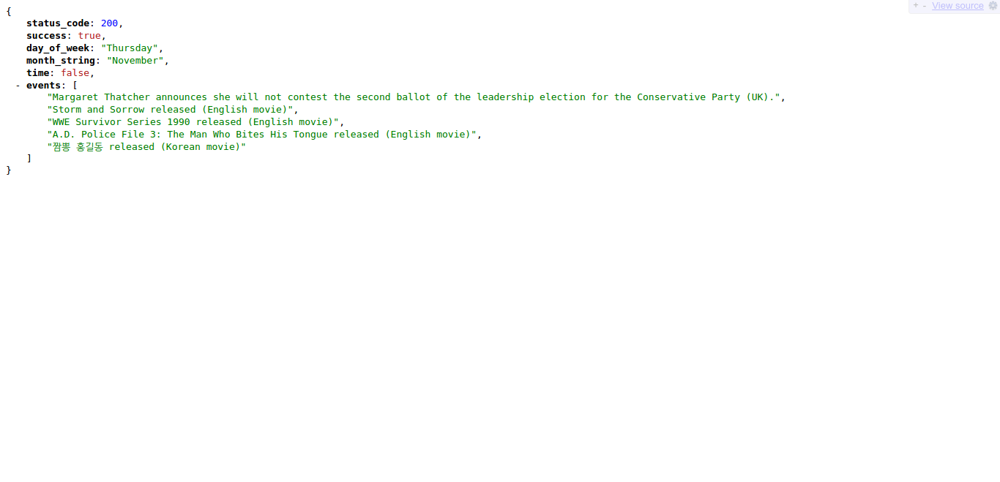
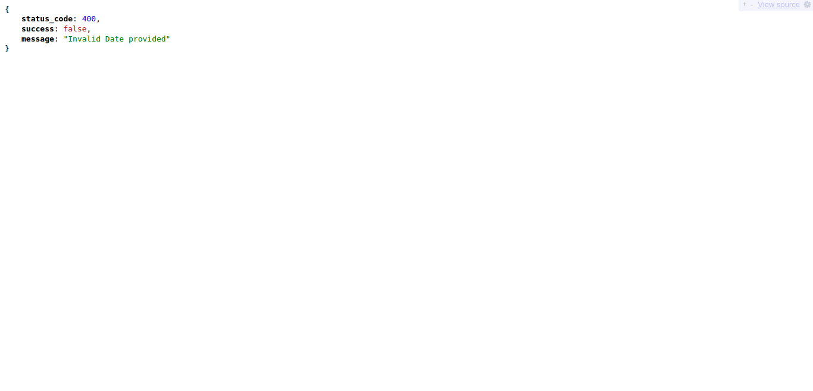

# Date Info

This is a simple API which let's the user fetch the events in JSON format which happened or would happen on a specific date. API takes 3 parameters as day in date, month and year format.

| Parameter | Value |
|---|---|
| day | day of month in DD or D format |
| month | month in MM or M format |
| year | year in YYYY format |

* * * * 

Response

| Key | Meaning | Possible Values |
|---|---|---|
| success | It basically helps in checking whether the data is recieved or not, as of now this can be ignored since one can check the same  using the **status code** | true , false |
| message | If the **success** flag is **false**, this parameter gives the reason why the data is not recieved | string |
| day_of_week | If the **success** flag is **true**, then **day_of_week** gives the day of week on the date provided in input as a string | Monday, Tuesday, Wednesday, Thursday, Friday, Saturday, Sunday |
| month_string | If the **success** flag is **true**, then **month_string** gives the month in the date provided in input as a string | January, February, March, April, May, June, July, August, September, October, November, December |
| time |  If the **success** flag is **true**, then **time** and the date provided in the parameters is **before** the current / present date, then this flag is set to **false** else this flag is **true** | true , false |
| events | This returns all the events on the specified date as an array if the **success** flag is **true** | JSON array |

* * * *

## Successful response

 

* * * *

## Unsuccessful response

 

* * * *

* * * *

## Hosting on GitHub Pages

The API also runs as plain JavaScript, so it can be served by GitHub Pages with no PHP server.

* `index.html` is the page. It reads the query string, calls `getDateInfo` and shows only the JSON text.
* `js/date-info.js` is a dependency-free ES module with the same logic as `index.php`. It also works in Node 24: `getDateInfo(new URLSearchParams('day=21&month=10&year=2015'))` resolves to the same body the PHP API echoes.
* `.nojekyll` tells GitHub Pages to serve the files as they are.

To publish, enable GitHub Pages for the branch in the repository settings (source: the repository root). Then call it the same way as the PHP API:

```
https://<user>.github.io/date-info/?day=21&month=10&year=2015
```

Run the unit tests with `node --test js/date-info.test.mjs`.

Caveats:

* GitHub Pages only serves static files, so the response is an HTML page whose visible text is the JSON. The JSON text is identical to the PHP API's, but the HTTP `Content-Type` is `text/html`, not `application/json`.
* The vizgr historical-events service is http-only and currently times out. A page served over https cannot call it, so in the browser it adds no events. That matches what the PHP API returns today, since its vizgr request times out too.
